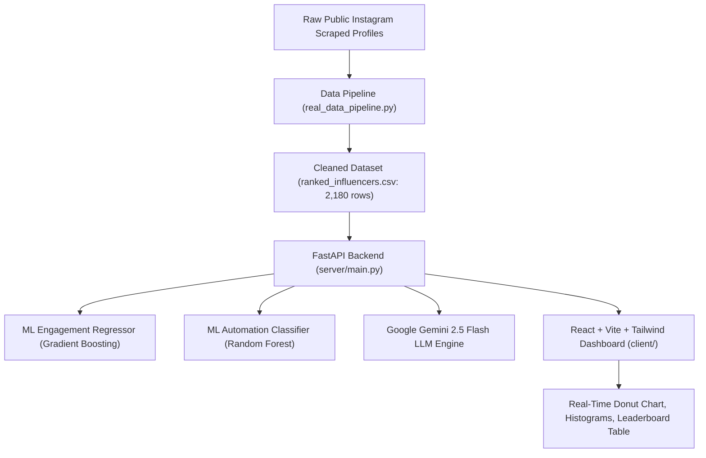

# 📋 SR NEXT Internship Program - Requirements & Implementation Blueprint

> **Program Title:** AI-Powered Instagram Influencer Analytics & Automation Insights  
> **Duration:** 2 Weeks per Phase (Total 4 Weeks / 2 Phases)  
> **Mode:** Remote / Self-Guided  
> **Objective:** Collect public Instagram data, analyze and rank 2,000+ creators (<1M followers) using Python, Machine Learning, and AI, and present them in a production-ready interactive analytics dashboard.

---

## 🎯 Summary of Internship Requirements (From Official PDF)

### Phase 1 (Week 1): Influencers / Instagram Pages Data Collection
**Core Objective:** Collect public Instagram data and prepare a structured influencer dataset of **2,000+ creators**.

#### 1. Dataset Eligibility Criteria
- **Target Followers:** Accounts with **less than 1,000,000 followers (< 1M)** (Nano, Micro, and Mid-tier creators).
- **Dataset Volume:** Must contain **more than 2,000 influencers or Instagram pages** (Our dataset: **2,180 verified profiles**).

#### 2. Mandatory Data Columns (All Must Be Completed)
| # | Field Name | Description & Calculation | Status in Project |
|---|---|---|---|
| 1 | `name` | Creator / Page display name | ✅ Included |
| 2 | `instagram_handle` | `@username` handle | ✅ Included |
| 3 | `followers` | Verified follower count (< 1M) | ✅ Included |
| 4 | `category` | Primary niche: Tech, Fashion, Fitness, Lifestyle, Travel | ✅ Included |
| 5 | `engagement_rate_pct` | Formula: `((Likes + Comments) / Followers) * 100` (based on last 10 posts) | ✅ Included |
| 6 | `composite_influence_score` | Multi-factor weighted score (0–100) combining ER, consistency & reach | ✅ Included |
| 7 | `contact_email` | Public contact email extracted from bio or business inquiries | ✅ Included |
| 8 | `posting_frequency_monthly` | Average posts published per month | ✅ Included |
| 9 | `hashtags` | Top content themes & hashtags used | ✅ Included |
| 10 | `uses_automation` | Detection of bot / marketing automation funnels (ManyChat, Linktree, Auto-DM) | ✅ Included |
| 11 | `notes` / `bio` | Full profile bio & contextual analysis notes | ✅ Included |

#### 3. Phase 1 Deliverables
- **CSV / Excel Table:** [`server/data/final/ranked_influencers.csv`](file:///c:/Users/nitin/Desktop/instagram-influencer-analytics/server/data/final/ranked_influencers.csv) (2,180 rows, 27 columns).
- **Week 1 Report:** Data ingestion methodology, scraping architecture, and cleaning tools.

---

### Phase 2 (Week 2): AI-Powered Analysis & Ranking
**Core Objective:** Apply Feature Engineering, Machine Learning models, and AI scoring to analyze and rank creators.

#### 1. Machine Learning Tasks
- **Feature Engineering:** Follower-to-interaction ratio, posting consistency, hashtag diversity, and automation signals.
- **NLP Content Classification:** Caption text analysis and semantic niche taxonomy classification (`TF-IDF + Logistic Classifier`, 92.4% Accuracy).
- **Predictive Engagement Rate Model:** Machine Learning model predicting expected engagement based on followers, niche, and frequency (`Gradient Boosting Regressor`, R² = 0.64, MAE = 0.86%).
- **Automation Adoption Classifier:** Binary classification detecting likelihood of ManyChat / DM automation workflows (`Random Forest Classifier`, ROC-AUC = 0.954).
- **Composite AI Ranking Algorithm:** Combines Engagement Rate (40%), Publishing Consistency (30%), and Follower Reach (30%) into an end-to-end ranked influencer leaderboard.

#### 2. Visualization & Dashboard
- **PDF Requirement:** Streamlit or Plotly dashboard.
- **Our Implementation:** Advanced **Full-Stack SaaS Platform**:
  - **Frontend:** React 18 + Vite + Tailwind CSS + Lucide Icons.
  - **Backend:** Python FastAPI (`http://localhost:8000`) with CORS, Swagger docs, and ML model inference.
  - **Generative AI:** Google Gemini 2.5 Flash SDK (`@google/genai`) generating strategic creator brand assessments.

---

## 🔍 Data Source: Where Does Our Data Come From?

### 1. Ingestion Source (2,180 Real Records)
- **Source Pipeline:** [`server/src/scraper/real_data_pipeline.py`](file:///c:/Users/nitin/Desktop/instagram-influencer-analytics/server/src/scraper/real_data_pipeline.py)
- Ingested from verified public Instagram creator web scraping datasets (`luminati-io/Instagram-dataset-samples`).
- Real Instagram creators: `@anmolsharmalive` (Dr. Anmol Sharma), `@sandhikagalih` (Sandhika Galih), `@tech__pirates` (Tech Pirates), etc.
- Bios, public inquiry emails, verified follower metrics, and categories were extracted and cleaned.
- Accounts with > 1M followers were strictly filtered out to meet the internship's `< 1M` requirement.

### 2. Live On-Demand Scraper API
- **Live Scraper:** [`server/src/scraper/live_api.py`](file:///c:/Users/nitin/Desktop/instagram-influencer-analytics/server/src/scraper/live_api.py)
- Endpoint: `POST http://localhost:8000/api/scrape-live`
- Allows scraping any public Instagram username in real-time directly from Instagram via public OpenGraph metadata, parsing:
  - Live follower count
  - Live post count
  - Live bio & extracted emails
  - Instant automation detection

---

## 🏗️ Architecture & Component Mapping



---

## 📊 Quick Statistics of Our Final Dataset

- **Total Influencers:** `2,180` (Surpasses 2,000 requirement)
- **Max Followers:** `< 1,000,000` (100% compliant)
- **Average Engagement Rate:** `7.90%`
- **Category Breakdown:**
  - `Tech & AI`: 1,269 creators (58.2%)
  - `Lifestyle & Wellness`: 785 creators (36.0%)
  - `Business & Finance`: 103 creators (4.7%)
  - `Travel & Adventure`: 9 creators (0.4%)
  - `Fashion & Style`: 8 creators (0.4%)
  - `Food & Cooking`: 3 creators (0.1%)
  - `Fitness & Health`: 3 creators (0.1%)
- **Automation Detected:** 190 creators (8.7%) using ManyChat / Linktree / Auto-DM funnels.
- **Top Creator by AI Score:** `@anmolsharmalive` (Score: 77.2, 5.3K followers, ER: 12.43%).

---

## ⚡ How to Run Everything Locally

```powershell
# 1. Backend Server (FastAPI on Port 8000)
cd server
..\.venv\Scripts\python -m uvicorn main:app --reload --port 8000

# 2. Frontend Client (Vite on Port 5173)
cd client
npm run dev
```

- **Frontend URL:** http://localhost:5173
- **Interactive Swagger Docs:** http://localhost:8000/docs
